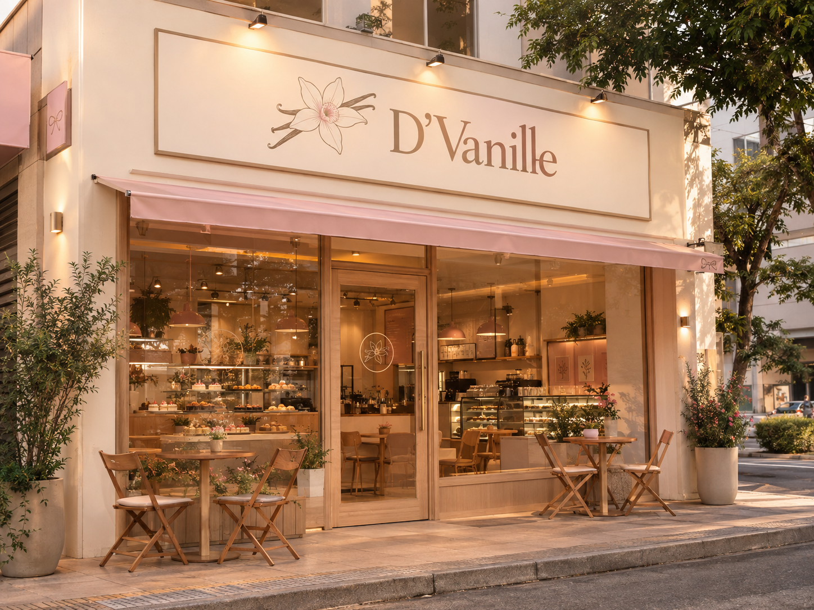
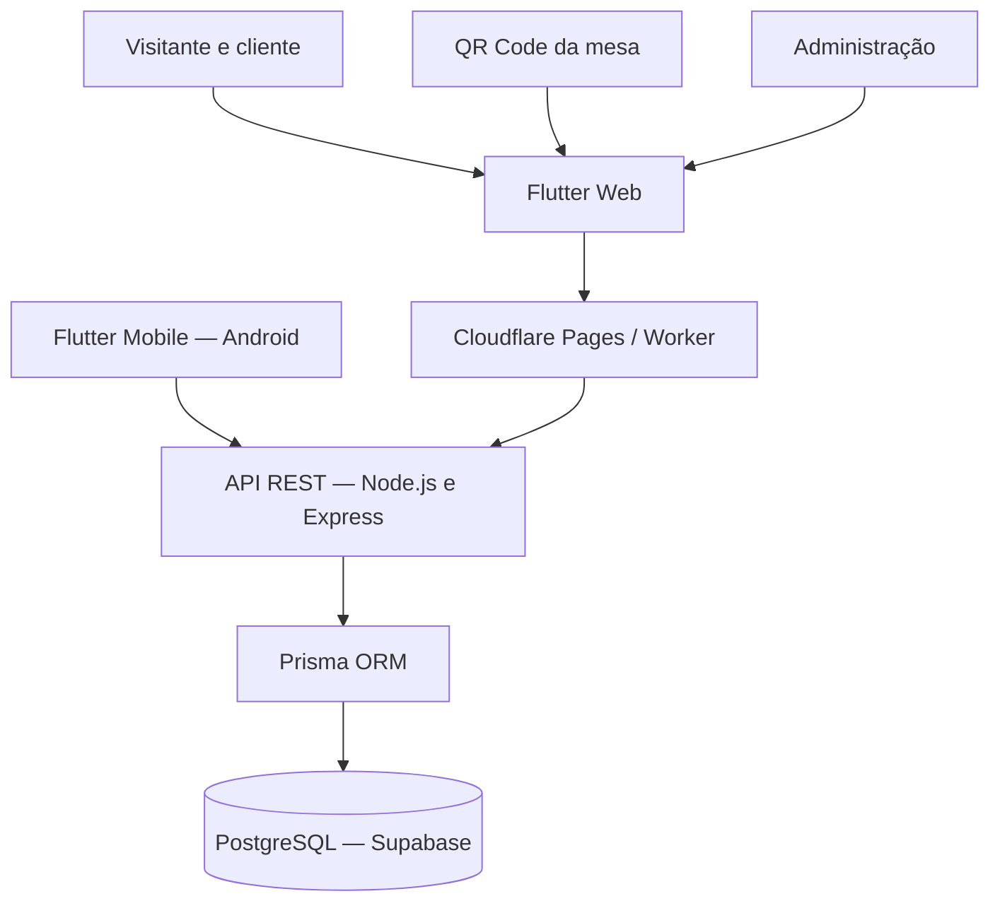

<div align="center">


# D’Vanille

### Sabor que acolhe. Tecnologia que inclui.

**Cafeteria inclusiva e tecnológica | Trabalho de Conclusão de Curso — Desenvolvimento de Sistemas**

[](https://flutter.dev/)
[](https://nodejs.org/)
[](https://supabase.com/)
[](https://www.prisma.io/)

**[🌐 Acessar o site](https://dvanille-web.pages.dev)** · **[📖 Documentação da API](https://dvanille-api.onrender.com/api/docs)** · **[📷 Instagram](https://www.instagram.com/dvanille.cafeteria/)** · **[📑 Documentação do projeto](https://docs.google.com/document/d/1OtdmenhZNFNmTPohBb1e76ibo0l-2LzJ6I6452iaB8k/edit?usp=sharing)**

</div>

---

## ✨ Sobre o projeto

A **D’Vanille** é um projeto acadêmico de cafeteria que une **inclusão alimentar**, **experiência digital** e **gestão integrada**. Seu propósito é facilitar a consulta de produtos, ingredientes e informações alimentares, ao mesmo tempo em que oferece atendimento presencial por QR Code e pedidos de delivery ou retirada pelo aplicativo.

O sistema foi desenvolvido como **Trabalho de Conclusão de Curso (TCC)** da turma **DS2B — Técnico em Desenvolvimento de Sistemas**.

> **A proposta:** oferecer uma experiência acolhedora e informativa a pessoas com diferentes necessidades e preferências alimentares, sem tratar filtros digitais como garantia médica de segurança alimentar.

<div align="center">
  
</div>

## 🧩 Ecossistema integrado

O projeto reúne três aplicações em um **único repositório**, com uma API e um banco de dados compartilhados.

| Componente | Tecnologia | Papel no sistema |
| :--- | :--- | :--- |
| **Web** | Flutter + Dart | Site institucional, cardápio, reservas, vale-presentes, comanda por QR Code e painel administrativo |
| **Mobile** | Flutter + Dart | Aplicativo Android para consulta do cardápio, favoritos, carrinho e pedidos de delivery ou retirada |
| **BackEnd** | Node.js + Express + Prisma | API REST compartilhada; autenticação, produtos, estoque, pedidos, reservas e administração |
| **Banco de dados** | PostgreSQL + Supabase | Persistência central dos dados do projeto |
| **Hospedagem Web** | Cloudflare Pages | Publicação do Flutter Web e proxy de requisições `/api` |
| **Hospedagem da API** | Render | Execução do Backend em produção |

### Visão da arquitetura



**Uma regra essencial:** o **site público não possui carrinho de produtos para delivery**. Os pedidos de alimentos pelo Web são exclusivamente presenciais, na **Comanda da Mesa**, acessada pelo QR Code. O **carrinho de delivery e retirada pertence ao aplicativo Mobile**.

## 💗 Funcionalidades

### 🌐 Site Web

- Página inicial, apresentação da cafeteria, contatos e informações institucionais.
- Cardápio digital com busca, categorias, ofertas e informações dos produtos.
- Ingredientes, alergênicos e informações nutricionais cadastradas.
- Filtros alimentares combináveis e preferências do usuário.
- Login, cadastro, perfil e recuperação de senha.
- Reservas de mesas e acompanhamento das reservas.
- Página de vale-presentes, respeitando as regras do projeto.
- Interface responsiva e opções de tema claro/escuro.

### 📱 Aplicativo Mobile

- Catálogo de produtos e pesquisa.
- Filtros por categoria e restrições alimentares.
- Favoritos, carrinho e gerenciamento de itens.
- Pedidos de **delivery** ou **retirada**.
- Autenticação e integração com a API compartilhada.
- Acompanhamento dos pedidos e informações do perfil.
- Aplicativo Android compilado e validado em dispositivo físico durante o projeto.

### ☕ Autoatendimento presencial via QR Code

- Identificação da mesa pelo QR Code.
- Montagem e edição da comanda antes do login.
- Autenticação necessária **ao enviar** o pedido ao caixa.
- Consulta dos totais e descontos aplicáveis.
- Envio dos pedidos ao atendimento da cafeteria.
- **Baixa automática de estoque** ao registrar a comanda.
- **Bloqueio de pedidos com estoque insuficiente**, sem permitir quantidade negativa.

### 🧑‍💻 Painel administrativo

- Dashboard com indicadores reais da API.
- Cadastro, edição, consulta e desativação de produtos.
- Quantidades em estoque, sinalização de estoque baixo/esgotado e reposição.
- Gerenciamento de pedidos, comandas QR Code e reservas.
- Acesso administrativo protegido por autenticação e autorização.
- Módulos de usuários e vale-presentes conforme o escopo demonstrativo.

## 🥐 Cardápio e inclusão alimentar

**Categorias:** bolos, salgados, doces, sobremesas geladas, bebidas quentes e bebidas geladas.

**Filtros disponibilizados:** sem APLV, sem soja, sem oleaginosas, sem açúcar adicionado, sem sal adicionado, low FODMAP, low carb, sem aditivos artificiais, vegano, vegetariano, sem lactose e sem glúten.

> ⚠️ **Atenção:** os filtros dependem dos dados cadastrados. Pessoas com alergias ou necessidades médicas devem confirmar ingredientes e possíveis riscos de contaminação cruzada. O sistema não substitui orientação profissional.

## 🛍️ Regras de negócio importantes

| Tema | Regra |
| :--- | :--- |
| **Pedidos de alimentos no Web** | Exclusivamente pelo fluxo presencial de comanda QR Code |
| **Delivery e retirada** | Fluxos do aplicativo Mobile |
| **Estoque** | A API verifica disponibilidade e desconta as unidades ao criar pedidos/comandas compatíveis |
| **Vale-presente** | Uso **somente presencial**, **uma única vez** e **sem saldo residual** |
| **Autenticação QR Code** | Navegação e montagem da comanda livres; login exigido no envio |
| **Pagamentos** | O projeto não processa pagamentos reais; recursos de demonstração não representam transações financeiras efetivas |
| **Segurança alimentar** | Filtros informativos, sujeitos à verificação de ingredientes e alergênicos |

**Vale-presentes:** o resgate consome integralmente o código, mesmo quando a compra é inferior ao valor nominal. Ele não funciona como meio de pagamento no site ou aplicativo. A emissão vinculada a pagamento real depende de integração comercial específica, não incluída nesta demonstração acadêmica.

## 🗂️ Estrutura do monorepositório

```text
DVanille-TCC/
├── BackEnd/                  # API REST Node.js, Express, Prisma
│   ├── src/
│   │   ├── controllers/
│   │   ├── routes/
│   │   ├── services/
│   │   ├── middlewares/
│   │   └── config/
│   ├── prisma/              # Schemas e arquivos de banco
│   ├── docs/                # Documentação da API
│   ├── tests/
│   └── package.json
│
├── Mobile/                   # Aplicativo Flutter Android
│   ├── lib/
│   ├── assets/
│   ├── android/
│   └── pubspec.yaml
│
├── Web/                      # Site e painel Flutter Web
│   ├── lib/
│   │   ├── pages/
│   │   ├── services/
│   │   ├── models/
│   │   ├── theme/
│   │   └── widgets/
│   ├── assets/
│   ├── web/_worker.js       # Proxy para a API hospedada
│   └── pubspec.yaml
│
└── README.md                 # Visão geral e documentação unificada
```

## 🚀 Executando o projeto

### Requisitos

- Git e Visual Studio Code (ou editor equivalente).
- **Flutter SDK** instalado e configurado (`flutter doctor`).
- **Node.js 20+** e npm para o Backend.
- Docker, se optar por um ambiente de desenvolvimento em contêineres.
- Acesso a um banco configurado para o schema de execução escolhido.

### 1 — Web

No PowerShell, a partir da raiz do monorepositório:

```powershell
cd Web
flutter pub get
flutter run -d chrome --web-port=8080 --dart-define=DVANILLE_API_URL=https://dvanille-web.pages.dev/api
```

Para desenvolver contra um Backend local na porta 3000, utilize `http://localhost:3000/api` no `--dart-define`, e configure corretamente CORS e autenticação.

### 2 — Mobile

```powershell
cd Mobile
flutter pub get
flutter run --dart-define=DVANILLE_API_URL=https://dvanille-api.onrender.com/api
```

Para compilar o APK de demonstração:

```powershell
flutter build apk --release --dart-define=DVANILLE_API_URL=https://dvanille-api.onrender.com/api
```

O APK gerado fica em `Mobile/build/app/outputs/flutter-apk/app-release.apk`.

### 3 — Backend

```powershell
cd BackEnd
npm ci
```

Configure um arquivo `.env` **somente no seu computador**, com variáveis adequadas ao ambiente. O arquivo `BackEnd/.env.example` e parte da documentação interna ainda descrevem o ambiente **legado MySQL**; não utilize essa configuração como se fosse a instância PostgreSQL de produção.

Para a configuração PostgreSQL/Supabase utilizada na integração, o projeto contém o schema `BackEnd/prisma/schema_supabase_confirmado.prisma`:

```powershell
npx prisma generate --schema=prisma/schema_supabase_confirmado.prisma
npm start
```

O Backend precisa de uma `DATABASE_URL` válida e das demais variáveis exigidas pelo ambiente. **Não publique o `.env`, tokens, JWT_SECRET ou credenciais do Supabase.** Não execute `db push`, resets, migrations ou seeds no banco compartilhado sem planejamento e backup.

### API e testes

- **Health check:** `https://dvanille-api.onrender.com/api/health`
- **Swagger:** `https://dvanille-api.onrender.com/api/docs`
- **Referência técnica:** [`BackEnd/docs/API.md`](BackEnd/docs/API.md)
- **Testes automatizados do Backend:** `cd BackEnd` e `npm test` (alguns testes dependem de um ambiente próprio configurado).

## ☁️ Implantação atual

| Serviço | Endereço / observação |
| :--- | :--- |
| **Web** | https://dvanille-web.pages.dev |
| **API** | https://dvanille-api.onrender.com/api |
| **Banco** | PostgreSQL hospedado no Supabase; credenciais mantidas fora do código |
| **Proxy Web → API** | `Web/web/_worker.js`, copiado para a compilação do Cloudflare |

A versão Web publicada utiliza o endpoint `/api` no próprio domínio do Cloudflare, encaminhado pelo Worker à API no Render. Isso ajuda a manter a autenticação por cookie HttpOnly no contexto do site.

**Compilação Web adotada no projeto (PowerShell, dentro de `Web/`):**

```powershell
flutter build web --release --optimization-level=1 --no-wasm-dry-run --dart-define=DVANILLE_API_URL=https://dvanille-web.pages.dev/api
Copy-Item .\web\_worker.js .\build\web\_worker.js -Force
```

A pasta `Web/build/web` resultante é a que deve ser enviada ao Cloudflare Pages. Não envie apenas os fontes Flutter.

> **Nota sobre a migração:** este monorepositório reúne o código e os históricos para organização e apresentação. Até reconfigurar os serviços de hospedagem, o Render continuará acompanhando o repositório antigo do Backend; a atualização do monorepositório, sozinha, **não altera a implantação de produção**. Mantenha os repositórios originais disponíveis durante a transição.

## 🛡️ Segurança, limites e escopo acadêmico

- Senhas, tokens, links privados e credenciais são gerenciados por variáveis de ambiente, não pelo README.
- Endpoints administrativos exigem autenticação e autorização apropriadas.
- O controle de estoque no QR Code foi testado no ambiente local e na versão publicada do projeto.
- Pagamentos reais e emissão comercial de vale-presentes **não são anunciados como ativos**.
- Este projeto é um **protótipo acadêmico funcional** e não deve ser interpretado como uma operação comercial em produção plena.
- O plano gratuito de hospedagem da API pode ocasionar demora após períodos de inatividade.

## 👩‍💻 Equipe e contexto acadêmico

**Projeto:** D’Vanille — Cafeteria Inclusiva e Tecnológica
**Equipe:** ANA CLARA TORRES, JULIA LLORENTE, YASMIN BERNARDES, VIVIANE DIAS E KARINA SOUZA.
**Formação:** Técnico em Desenvolvimento de Sistemas
**Turma:** DS2B
**Finalidade:** Trabalho de Conclusão de Curso

Desenvolvimento colaborativo do **grupo D’Vanille**, reunindo interface, aplicativo, API, banco de dados, integração, testes e documentação.

### Repositórios de origem

- **Flutter Web:** [Llorenteju/TCC_D-VANILLE_WEB](https://github.com/Llorenteju/TCC_D-VANILLE_WEB) — branch `integracao-reservas-web`.
- **Backend + Mobile:** [karinasnascimento/DVanille](https://github.com/karinasnascimento/DVanille) — branch `integracao-reservas-api`.

Este repositório consolida os códigos mantendo o histórico dos projetos de origem, sem substituir automaticamente suas configurações de deploy.

---

<div align="center">

**D’Vanille — Sabor que acolhe. Tecnologia que inclui.** 💗

*Tecnologia a serviço de experiências mais acessíveis e acolhedoras.*

</div>
